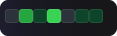
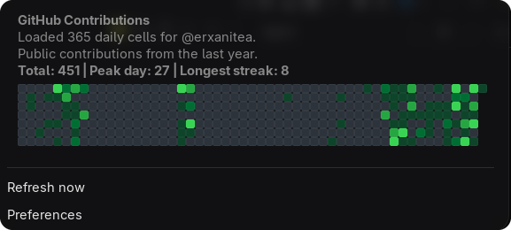

<div align="center">


# GitHub Contribution Grid

**A modern, lightweight GNOME Shell extension that brings your GitHub contribution graph directly to your top panel and dropdown menu.**

[](https://extensions.gnome.org)
[](LICENSE)
[](https://gitlab.gnome.org/GNOME/gnome-shell)
[](metadata.json)

<br/>

### 🖥️ Previews

#### Top Bar Mini Grid
*A compact 7-day glanceable activity indicator integrated seamlessly into the GNOME top panel:*



<br/>

#### Interactive Full Year Heatmap & Stats
*Click the top bar indicator to open the complete 53-week activity grid, streak statistics, and quick controls:*



<br/>

</div>

---

## ✨ Features

- **⚡ Top Panel Glance**: Instant visual summary of the last 7 days right in the GNOME status bar.
- **📊 53-Week Activity Heatmap**: Complete 365-day contribution calendar with hover tooltips showing date and commit counts.
- **🔥 Streak & Milestone Metrics**: Displays total yearly contributions, peak activity count, and current/longest streak.
- **🎨 10 Curated Color Themes**: Includes GitHub Classic, Emerald Green, Ocean Blue, Electric Purple, Sunset Orange, Cyberpunk Teal, Halloween Gold, Rose Pink, Amber Gold, and Monochrome Slate.
- **🖌️ Custom Accent Palette**: Choose any hex color code with live preview and automatic multi-shade interpolation.
- **💾 Offline-First Caching**: Fast startup rendering using local cached results, with seamless background synchronization.
- **🔒 Public & Authenticated Modes**: Works immediately with any public profile without tokens, with optional GitHub token support for private contributions.
- **🧩 Libadwaita Preferences**: Modern GNOME settings interface adhering to the GNOME Human Interface Guidelines.

---

## 🎨 Color Themes

| Theme Name | Style Description | Palette Preview |
| :--- | :--- | :--- |
| **GitHub Classic** | The authentic GitHub dark mode green palette | `#2d333b` → `#39d353` |
| **Emerald Green** | Rich deep emerald forest tones | `#2d333b` → `#34d399` |
| **Ocean Blue** | Cool aquatic azure shades | `#2d333b` → `#7dd3fc` |
| **Electric Purple** | Vibrant neon violet & lavender | `#2d333b` → `#c4b5fd` |
| **Sunset Orange** | Warm ember and twilight sunset hues | `#2d333b` → `#fb923c` |
| **Cyberpunk Teal** | High-contrast synthwave neon teal | `#2d333b` → `#48cae4` |
| **Halloween Gold** | Seasonal pumpkin spice & gold | `#2d333b` → `#fddf68` |
| **Rose Pink** | Soft crimson and rose pastel gradient | `#2d333b` → `#fb7185` |
| **Amber Gold** | Warm vintage amber glow | `#2d333b` → `#fbbf24` |
| **Monochrome Slate** | Minimalist clean grayscale | `#2d333b` → `#cbd5e1` |
| **Custom Color** | Dynamic color ramp generated from any custom hex code | User-selected |

---

## 🚀 Installation

### Option 1: Install from GitHub Releases (Recommended)

1. Download the latest `github-contribution-grid@erxanitea.shell-extension.zip` from the [Releases](https://github.com/erxanitea/gnome-github-contribution-grid/releases) page.
2. Install via terminal:
   ```bash
   gnome-extensions install github-contribution-grid@erxanitea.shell-extension.zip --force
   ```

### Option 2: Install from Source

Ensure you have `git`, `make`, and `glib2.0` (for `glib-compile-schemas`) installed:

```bash
git clone https://github.com/erxanitea/gnome-github-contribution-grid.git
cd gnome-github-contribution-grid
make install
```

### Reload & Enable

#### On Wayland:
Log out and log back in to reload GNOME Shell, then enable:

```bash
gnome-extensions enable github-contribution-grid@erxanitea
```

#### On X11:
Press `Alt + F2`, type `r`, and hit `Enter`, then enable:

```bash
gnome-extensions enable github-contribution-grid@erxanitea
```

You can also manage and enable the extension graphically using **Extension Manager**:

```bash
flatpak install flathub com.mattjakeman.ExtensionManager
```

---

## ⚙️ Configuration

Open extension preferences either through the dropdown menu item or via terminal:

```bash
gnome-extensions prefs github-contribution-grid@erxanitea
```

### Available Settings

| Setting | Default | Description |
| :--- | :--- | :--- |
| **GitHub Username** | `""` *(empty)* | GitHub handle whose contribution graph will be displayed. |
| **Refresh Interval** | `60` min | Frequency in minutes between background refreshes (5 to 1440 min). |
| **Color Theme** | `GitHub Classic` | Select one of the 10 preset themes or choose custom color. |
| **Custom Accent Color** | `#39d353` | Custom color picker or hex input when using the Custom Theme. |
| **GitHub Token** | `""` *(Optional)* | Personal access token for private contributions and higher rate limits. Direct link to create token available in Preferences. |

---

## 🛠️ Development

Build and package the extension zip bundle:

```bash
# Compile schemas
make

# Create shell extension distribution package (.zip)
make pack

# Clean build artifacts
make clean
```

---

## 📄 License

This project is licensed under the [GNU General Public License v3.0 or later (GPL-3.0-or-later)](https://www.gnu.org/licenses/gpl-3.0.html).
